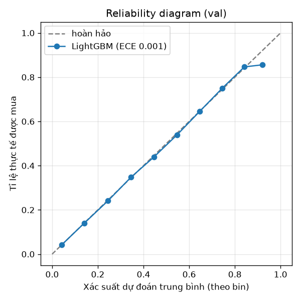

# Báo cáo: dự đoán mua lại (predictive reorder)

*Ngày 2026-10-23 · nhánh `feature/predictive-reorder` · dữ liệu Instacart, 20.000 user*

## Kết luận

**Model gate: QUA.** Trên tập test, chạy đúng một lần, LightGBM đạt **Recall@15 = 0,431**, cao hơn baseline tốt nhất là TIFU-KNN (0,417). LightGBM cũng dẫn đầu ở mọi metric còn lại. Model được calibrate tốt (ECE 0,001 cả khi chia bin theo quantile; Brier 0,082 so với 0,102 của dự đoán hằng bằng tỉ lệ nền), nên xác suất dự đoán dùng được trực tiếp để quyết định có gợi ý một món hay không.

## Bài toán

Với mỗi khách, dự đoán những món **đã từng mua** sẽ có trong đơn tiếp theo, và gợi ý tối đa 15 món. Model chấm điểm từng món trong lịch sử mua của khách (tối đa 100 món mỗi khách), rồi xếp hạng theo xác suất được mua.

## Dữ liệu và cách đánh giá

- **Dữ liệu**: Instacart, gộp prior và train. Giữ khách có ít nhất 5 đơn, lấy ngẫu nhiên 20.000 khách (seed 42).
- **Split theo từng khách**:
  - đơn cuối là **test**;
  - đơn kế cuối là **val**;
  - các đơn còn lại là **train**: dùng các đơn T−2, T−3, T−4 làm nhãn, các đơn trước đó để tính feature.
- **Chống rò rỉ**: feature chỉ dùng các đơn đứng trước đơn cần dự đoán. Điều này được kiểm tra tự động bằng test, trong đó có test tính lại feature từ dữ liệu gốc. Chi tiết trong [scripts/data_prep.py](../scripts/data_prep.py).
- **Metric**: Recall@15, NDCG@15, F1@15, Precision@20. Tính trên **giỏ hàng thật đầy đủ**, kể cả món khách chưa từng mua, rồi lấy trung bình theo đơn.
- **Quy trình**: chọn feature, tham số, τ và kiểm tra calibration đều chỉ trên val. Test được chạy **một lần duy nhất** ở bước cuối; script [scripts/final_eval.py](../scripts/final_eval.py) từ chối chạy lại.

## Kết quả trên test (một lần duy nhất)

| Phương pháp | Recall@15 | NDCG@15 | F1@15 | Precision@20 |
| --- | --- | --- | --- | --- |
| popularity | 0,0870 | 0,0987 | 0,0647 | 0,0521 |
| personal_freq (món mua nhiều nhất) | 0,4024 | 0,4143 | 0,2625 | 0,2055 |
| TIFU-KNN (đã tune trên val) | 0,4172 | 0,4327 | 0,2740 | 0,2143 |
| **LightGBM** | **0,4311** | **0,4492** | **0,2848** | **0,2221** |

- So với TIFU-KNN: Recall@15 **+0,014**, NDCG@15 **+0,017**.
- Kết quả trên test rất gần val (Recall@15: 0,431 trên test, 0,434 trên val), nên không có dấu hiệu overfit vào val.
- **Mức trần**: khoảng 39% món trong giỏ thật là món khách chưa từng mua. Các món này nằm ngoài tập candidate, nên không phương pháp nào ở đây đoán được. Recall@15 của một oracle xếp mọi món đúng trong candidate lên đầu (vẫn giới hạn 15 món) là **0,601 trên val**. LightGBM đạt 0,434 trên val, khoảng 72% mức trần đó. Oracle được tính trên val (`scripts/select_threshold.py`) để không phải xem test lần nữa.

## Model

- **LightGBM**, `objective = binary`, early stopping theo logloss trên val, không dùng `scale_pos_weight`. Tham số mặc định: `num_leaves = 63`, `min_data_in_leaf = 100`, `learning_rate = 0,05`, dừng ở vòng 517.
- **23 feature** (bộ v4), mô tả trong [features.md](features.md). Không dùng `product_id` làm feature, để áp được cho catalog khác.
- **Ablation trên val** (NDCG@15):

  | Lượt | NDCG@15 |
  | --- | --- |
  | v0 | 0,432 |
  | v1 | 0,437 |
  | v2 | 0,440 |
  | v3 (khách và món) | 0,449 |
  | v4 (ngữ cảnh) | 0,449 |

  Feature của khách và món giúp nhiều nhất. Feature ngữ cảnh gần như không thêm gì.
- **Feature quan trọng nhất**: `up_decay` (tần suất mua có trọng số theo độ gần đây) chiếm 70% gain.
- **Chỉnh tham số**: tăng giảm `num_leaves` hay `min_data_in_leaf` chỉ thay đổi khoảng ±0,0006. Thêm đơn T−3, T−4 làm nhãn train cho +0,0012, và là cấu hình được chọn.
- **Kiểm tra tay 5 khách**: top-15 hợp lý. Đứng đầu là món mua thường xuyên và vừa mua gần đây.

## Ngưỡng τ và calibration



- **Calibration**: trên val, ECE = 0,0008 với 10 bin chia đều; trên test, ECE = 0,0013. Vì phần lớn xác suất nằm trong bin 0–0,1, ECE bin đều có thể che sai lệch, nên đã đo thêm trên val: **ECE với 10 bin quantile = 0,0010**, **Brier = 0,0815** (dự đoán hằng bằng tỉ lệ nền: 0,1022). Đường cong gần như trùng với đường chéo. Chỉ có bin cao nhất (dự đoán khoảng 0,92, thực tế 0,86, chỉ 562 dòng) là hơi tự tin quá. Vì ECE (cả hai cách chia bin) thấp hơn nhiều so với ngưỡng 0,02 nên **không cần isotonic**.
- **τ = 0,13**, chọn trên val theo F1@15. Một món được gợi ý nếu nằm trong top-15 **và** có xác suất ≥ τ.

  | | F1@15 | Precision | Recall | Số món gợi ý trung bình | Đơn không có gợi ý nào |
  | --- | --- | --- | --- | --- | --- |
  | val, τ = 0,13 | 0,318 | 0,321 | 0,379 | 10,4 | 0,8% |
  | val, không cắt (τ = 0) | 0,298 | 0,270 | 0,434 | 14,3 | 0% |
  | test, τ = 0,13 | 0,316 | 0,319 | 0,376 | 10,5 | 0,9% |

  Bảng này chia precision cho số món thực sự được gợi ý (không chia cho 15), nên khác F1@15 ở bảng kết quả (0,285). So sánh đúng là hai dòng val cùng định nghĩa: cắt bằng τ tăng F1@15 thêm **+0,020** (0,298 → 0,318), đổi lại recall giảm 0,055 và danh sách ngắn hơn khoảng 4 món.
- τ được ghi trong `weights/model_metadata.json`, cùng danh sách feature, tên file model và cách calibration. Code không viết cứng τ.

## Hạn chế

- **Không gợi ý được món mới**: 39% giỏ hàng là món khách chưa từng mua. Muốn vượt mức trần 0,60 thì cần thêm nguồn candidate, ví dụ món phổ biến trong aisle khách hay mua.
- **Val được dùng cho early stopping, chọn τ và đo calibration**, nên các con số trên val có thể hơi lạc quan. Kết quả test (ECE 0,0013, F1@15 với τ 0,316 so với 0,318 trên val) cho thấy ảnh hưởng này không đáng kể.
- **Chỉ chạy trên 20.000 khách.** Chưa chạy trên toàn bộ khoảng 200.000 khách.
- **Instacart không có ngày tuyệt đối**, nên split dựa trên thứ tự đơn của từng khách, không phải mốc thời gian chung.
- **Áp cho Bách Hóa Xanh**: feature không phụ thuộc mã sản phẩm, nhưng phân phối hành vi mua có thể khác Instacart. Cần đo lại trên dữ liệu thật trước khi đưa vào sử dụng.

## Tái lập kết quả

```bash
python -m scripts.data_prep --users 20000                                         # baseline, val/test
python -m scripts.data_prep --users 20000 --train-targets 3 --out-dir data/processed_tt3
python -m scripts.baselines --users 20000
python -m scripts.train_lgbm --versions v4 --data-dir data/processed_tt3 --tag selected --save-model
python -m scripts.select_threshold --data-dir data/processed_tt3                  # τ, calibration, metadata
python -m scripts.final_eval                                                      # test, chạy một lần
```

Kết quả gốc: `data/processed/final_test.json` (các lần chạy sau ghi vào `<data-dir>/final_test.json`), `data/processed*/lgbm_runs.jsonl`, `weights/model_metadata.json`. Nhật ký chi tiết của từng lần chạy: [experiments.md](experiments.md).

## Bước tiếp theo

1. Chuyển model sang ONNX (đã kiểm tra converter với model đồ chơi), và viết `/predict` dùng `extract_features` cùng τ đọc từ metadata.
2. Chạy toàn bộ pipeline trên toàn bộ khách.
3. Thử thêm nguồn candidate ngoài lịch sử mua để vượt mức trần 0,60.
